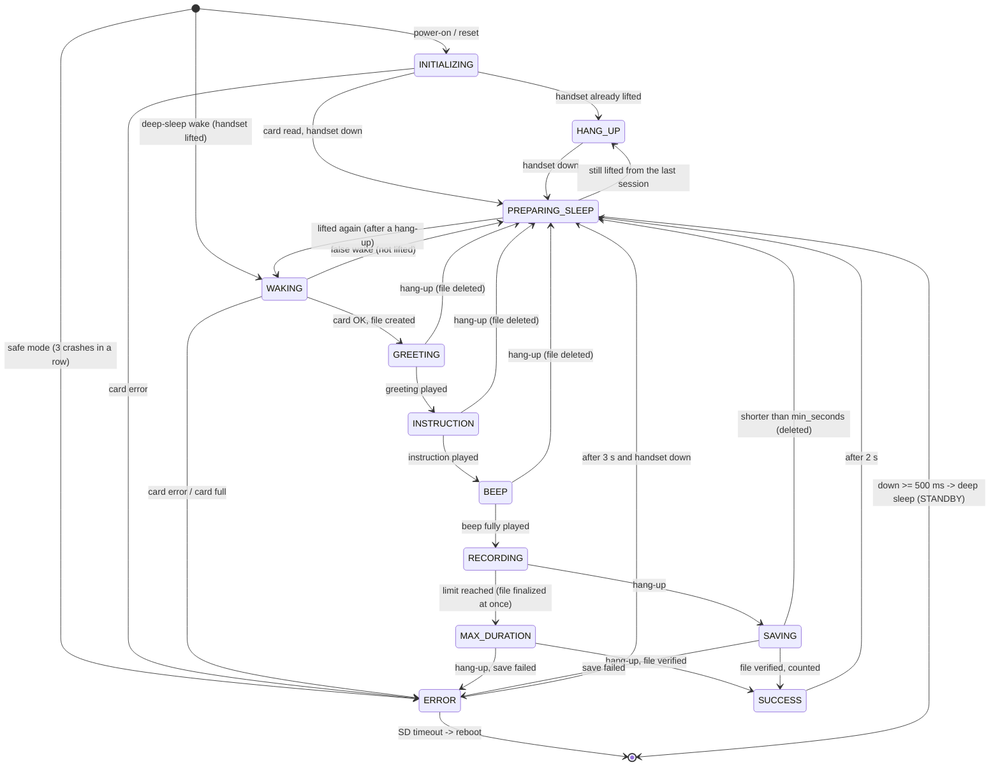
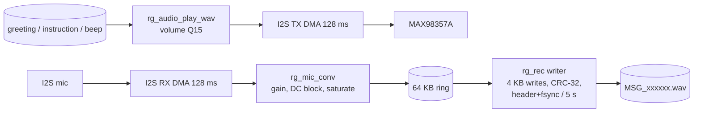

# Retro Audio Guestbook: firmware architecture (`firmware/guestbook`)

ESP-IDF v6.1.1, ESP32-C3. Hardware, pins and power: [`phase1-hardware-validation.md`](phase1-hardware-validation.md).

## 1. State machine

Every session starts from a deep-sleep wake, which is a fresh boot. No state leaks from one guest to the next. Standby *is* deep sleep: the OLED keeps the last standby frame and the peripheral rail is off.

| State | OLED | WS2812B | Rail | Notes |
|---|---|---|---|---|
| STANDBY (deep sleep) | AUDIO GUESTBOOK / TOPLAM: 024 / AHIZEYI KALDIRIN (`full`), count only (`minimal`), or panel off | off | **off** | ESP32 + OLED only |
| WAKING | HAZIRLANIYOR... | blue, short blink | on | lift must stay ≥ 60 ms; card mount, recovery, `config.txt`, catalog |
| GREETING | HOS GELDINIZ | yellow, slow breathing | on | WAV file already created (SD latency can never cost the first words) |
| INSTRUCTION / BEEP | SINYAL SESINDEN / SONRA KONUSUN | yellow, slow breathing | on | `beep.wav`, or a built-in 400 ms 1 kHz tone |
| RECORDING | MESAJINIZI BIRAKIN / 02:59 | green, breathing | on | countdown each second |
| MAX_DURATION | SURE DOLDU / LUTFEN AHIZEYI / YERINE KOYUN | yellow, solid | on | message already finalized (decision D9) |
| SAVING | KAYDEDILIYOR... | cyan, fast blink | on | header, fsync, close, re-open, verify |
| SUCCESS | KAYIT BASARILI / TOPLAM: 025 | green, solid 2 s | on | count and manifest updated only now |
| ERROR | KAYIT HATASI · KART HATASI · KART DOLU · SERVIS GEREKLI + hint | red, fast blink | on | min 3 s, until hang-up |
| HANG_UP | LUTFEN AHIZEYI / YERINE KOYUN | off | on | cold boot or session end with the handset still up |

Rules from the spec, and where they are enforced:

| Rule | Enforced in |
|---|---|
| Hang-up during greeting, instruction or beep: no recording | `gb_audio.c` deletes the pre-created file (`rg_rec_discard`) |
| Never report success before finalization | `gb_fsm.c` `on_saved()` only after `rg_rec_stop()` returns ESP_OK (or a verified salvaged file) |
| Recording starts only after the beep has finished | `rg_audio_drain()`, then `rg_audio_rx_flush()` |
| No deep sleep while lifted | PREPARING_SLEEP requires ≥ 500 ms debounced "down" |
| No session started by a cold boot | INITIALIZING never starts audio |
| Never an empty file | 0 samples, or fewer than `min_seconds`, are deleted |

## 2. Tasks

| Task | Prio | Stack | Job |
|---|---|---|---|
| `gb_audio` | 10 | 6 KB | I²S duplex: intro playback, capture, int16 conversion, pushes into the ring buffer |
| `rg_rec` (SD writer) | 5 | 4 KB | ring buffer → 4 KB SD writes, checkpoint every 5 s, CRC-32 |
| `gb_ui` | 3 | 3 KB | renders the UI model (≈13 ms I²C flush) |
| `rg_led` | 2 | 2.5 KB | 50 Hz effect rendering |
| main (FSM) | 1 | 10 KB | 10 ms tick: hook debounce, audio events, state transitions |

How the tasks share work:
- **Capture never waits on the SD card or the display.** The audio task is highest priority and only does non-blocking pushes into a 64 KB ring (≈2 s of audio).
- **Shared resources are each owned once.** I²S is owned by `gb_audio`, the SD file by `rg_rec`, the frame buffer by `gb_ui` (mutex), and the rail by `rg_power` (reference count).
- **Messages flow through FreeRTOS primitives.** The FSM talks to the audio task through a command queue (one session) plus a hang-up flag; the audio task answers through an event queue. The audio and SD writer tasks pass data through a single-producer single-consumer stream buffer.

## 3. Audio data path

- I²S: 16 kHz, Philips, 2×32-bit slots, BCLK 1.024 MHz, MCLK 512·fs. TX and RX are paired on I2S0 (shared BCLK/WS).
- The mic warms up (2¹⁸ SCK ≈ 256 ms) during the greeting.
- At the limit or on hang-up, the clocks stop and the pins float before the rail drops (`rg_audio_close` → `rg_power_release`).

## 4. Timing (all configurable)

| Setting | Default | Where |
|---|---|---|
| Hook debounce | 40 ms | menuconfig `RG_HOOK_DEBOUNCE_MS` |
| Lift confirmation after wake | 60 ms | `GB_WAKE_CONFIRM_MS` |
| Down before deep sleep | 500 ms | `GB_SLEEP_STABLE_MS` |
| Success screen | 2000 ms | `GB_SUCCESS_SCREEN_MS` |
| Error screen (minimum) | 3000 ms | `GB_ERROR_SCREEN_MS` |
| Save deadline → reboot | 5000 ms | `GB_SAVE_TIMEOUT_MS` (< task watchdog 10 s) |
| Ring buffer | 64 KB | `GB_RING_KB` (size from hardware test 5) |
| Rail settle | 30 ms | `RG_POWER_SETTLE_MS` |
| Max / min message, volume, gain, LED, contrast, standby screen, low-space warning | 180 s / 1 s / −6 dB / 12 dB / 40 / 0x30 / full / 30 min | `/audio/config.txt` |

## 5. Failure handling

| Failure | Behaviour |
|---|---|
| No card / unreadable | KART HATASI. Nothing recorded. Back to sleep after hang-up; the next lift retries. |
| Card full before a session | KART DOLU (needs ≥ 1 MB + 10 s of audio free). |
| Card full during a message | The recorder truncates to the last complete chunk and verifies it. The message is kept and counted; the standby screen shows KART DOLMAK UZERE. |
| SD write error | KAYIT HATASI. The file stays marked; the next boot repairs it if possible. |
| SD stops responding | The 5 s save deadline expires: error screen, then reboot. A watchdog panic after 10 s covers a fully stuck writer. The file is repaired on the next mount. |
| Power cut while recording | The next boot repairs the header from the file length (≤ 5 s lost), or deletes it if shorter than `min_seconds`. |
| Repeated crashes | After 3 in a row: SERVIS GEREKLI, card not touched, until power-cycled. The first crash dump stays in flash. |
| Bad greeting format | Skipped with a log warning; the guest still gets the beep and can record. |
| Ring buffer overflow | Counted as dropped bytes, logged with "(audio dropped: enlarge ring)". |

## 6. Energy

- **Deep sleep between every guest:** only the ESP32 + OLED are powered (rail off).
- **CPU at 80 MHz.**
- **Card writes during sessions:** the event log is written only on cold boot and on events (saved, failed, recovery, card full). It is never written on a plain wake or while recording.
- **NVS writes:** one per cold boot, three per message.
- **No folder scan on wake:** the catalog uses an RTC cache that is invalidated by a different card (CID).
- **Rail off as early as possible:** right after the result screen.

## 7. Soak test (Phase 5)

`sdkconfig.soak` builds a variant that simulates the handset and wakes by timer. It runs 100 complete sessions through the real code path, including deep sleep, and checks each outcome against a script:

| Session type (per 100 sessions) | Count | Expected outcome |
|---|---|---|
| normal 4 s message | 78 | saved |
| hang-up 200 ms into the greeting / beep | 10 | discarded |
| too-short message (hang-up 0.3 s after the beep) | 8 | discarded |
| maximum-length message (limit 10 s, hang-up 2 s later) | 4 | saved |

It ends with `RESULT SOAK PASS|FAIL sessions=… saved=… discarded=… errors=… mismatches=…`, which goes to the console and to `log.txt`. Procedure: [`testing.md`](testing.md).
