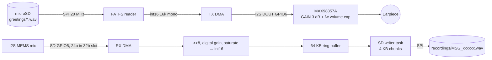
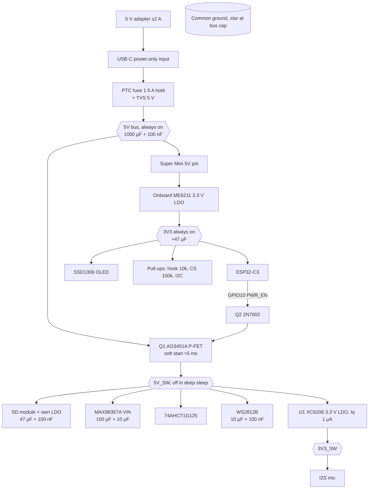

# Retro Audio Guestbook — Phase 1: Hardware Validation

Status: **APPROVED**. Open items were resolved as best-practice decisions (§10). Phase 2 test firmware: `firmware/hwtest` (see `firmware/README.md`).

Legend: **[V]** verified against a primary source (linked) · **[I]** inference / typical value, must be measured · **[U]** unknown, needs your input.

---

## 1. Verdict

The primary architecture fits on the ESP32-C3 Super Mini, **using all 13 exposed GPIOs, zero spare**.
Everything in the inventory is usable. Missing items are small passives, one logic buffer, a power switch (two MOSFETs and a tiny LDO), a multi-conductor handset cable, and power-entry parts (§8).

Two requirements changed after validation:

1. **Energy first: one switched 5 V peripheral rail** (GPIO10 `PWR_EN`) feeds the SD module, amplifier, WS2812B and level shifter, and a 1 µA LDO for the mic. In deep sleep everything except the ESP32 and the OLED is unpowered, so standby is ESP32 + OLED only (§6.3). This takes the GPIO that would otherwise control the amplifier's `SD_MODE`. The amp now shuts down with the rail instead of separately (risk and mitigation in §4.3).
2. **I²S runs full-duplex (shared BCLK/WS) for the whole session.** It is not torn down and reallocated between playback and recording. Sequential TX→RX reallocation is supported and stays as the tested fallback (§5).

---

## 2. Component compatibility

| Component | Key facts | Compatible? | Notes |
|---|---|---|---|
| ESP32-C3 Super Mini | 1× I²S controller with independent TX/RX channels [V][i2s]; GPIO0–5 are the only deep-sleep wake pins [V][gpio]; 13 GPIOs on headers (0–10, 20, 21) [V][sigmdel]; VBUS wired directly to the 5V pin [V][sigmdel]; ME6211 500 mA LDO per schematic, some batches reported weaker [V][sigmdel] | Yes | Wi-Fi/BT off during guest sessions; Wi-Fi only in the listening mode (`architecture.md` §8). USB-Serial-JTAG for flashing and logs. |
| I²S MEMS mic (6-pin: SD VDD GND L/R WS SCK) | Pin labels match common INMP441 breakouts [I]. INMP441: VDD 1.62–3.63 V, fSCK 0.5–3.2 MHz, fWS 7.8–50 kHz, **64 SCK per frame mandatory**, 24-bit two's-complement MSB-first, SD tri-states outside its slot, 100 kΩ SD pull-down recommended, zero output for 2¹⁸ SCK after power-up, standby (SCK stopped) 0.8 mA [V][inmp441] | Yes, if the IC is INMP441 or a pin-compatible 24-bit I²S part | **IC not confirmed [U].** Firmware treats it as a generic 24-bit-in-32-bit-slot Philips I²S mic. Test 6 checks the real bit depth. **Never connect VDD to 5 V** (abs max 3.63 V). |
| MAX98357A | VDD 2.5–5.5 V; 3.2 W/4 Ω, 1.8 W/8 Ω @5 V 10 % THD; quiescent 2.4–2.75 mA; shutdown 0.6 µA (SD_MODE < 0.16 V); standby 340 µA if BCLK is absent; BCLK must be 32/48/64× LRCLK; LRCLK only 8/16/32/44.1/48/88.2/96 kHz; **"do not remove LRCLK while BCLK is present" (risk of large DC output)**; SD_MODE trip points 0.16/0.77/1.4 V, internal 100 kΩ pull-down [V][max] | Yes | 16 kHz with 64× BCLK is a supported mode. Breakout (Adafruit-style) has a 1 MΩ SD→VIN pull-up, which gives (L+R)/2 mode at 5 V, and defaults to 9 dB gain [V][ada]. Speaker must be ≥4 Ω [V][ada]. Powered from the switched rail, so it draws 0 µA in standby. BCLK and LRCLK come from one generator and stop together; the rail is cut only after I²S is closed. |
| SSD1306 128×32 I²C | Keeps its image from internal GDDRAM while powered (no host refresh needed) [I, standard SSD1306 behaviour] | Yes | Power from **3.3 V** so the module's I²C pull-ups go to 3.3 V. |
| WS2812B | VIH = 0.7·VDD (3.5 V at 5 V); ESP32 3.3 V logic is below spec [I, WS2812B datasheet value] | Yes, **with a level shifter** | SN74AHCT1G125 (VIH 2.0 V at 5 V). |
| MicroSD SPI module | Onboard voltage regulator confirmed (user). The regulator drops ~1 V or more, so the module **must** get 5 V; at 3.3 V the card would be under-supplied | Yes | VCC = **5V bus**. The card and its logic side run at the regulator's 3.3 V, so the ESP32's 3.3 V signals are correct. Still to check: is the level translation done by a buffer IC (74LVC125/74HC125, 14-pin) or by resistor dividers? Dividers sized for 5 V MCUs would pull the ESP's 3.3 V down to ~2.2 V at the card. Only device on the bus, so a non-tri-stating MISO buffer is harmless. |
| Mechanical endstop | Type unknown [U] | Yes | Bare 3-terminal microswitch preferred. A PCB endstop with LED must have its VCC on **3.3 V**, and its LED draws current in standby. |
| Speaker | Impedance/power unknown [U] | Probably | Prefer 8 Ω, 0.5–1 W, ≤40 mm for the earpiece. Loudness is limited in hardware (GAIN) and firmware. |
| 5 V adapter | Rating/connector unknown [U] | Probably | ≥2 A recommended (≥1 A minimum with volume cap). |

Not used: ESP-12F, Pro Micro (no need), GY-MAX4466 (the C3 SAR ADC is noisier than the I²S mic; spare only if the I²S mic proves defective), PAM8403 (analog input; the C3 has no DAC).

---

## 3. GPIO assignment (ESP32-C3 Super Mini)

Constraints verified:
- Strapping: GPIO2 (pull up recommended against glitches), GPIO8 (must be 1 for download boot), GPIO9 (1 = SPI boot, weak pull-up, BOOT button) [V][c3ds][esp-book].
- Reset states: GPIO10 has input only, no pull. U0RXD (GPIO20) has a weak pull-up. U0TXD (GPIO21) has a weak pull-up and the ROM prints boot messages on UART0 by default [V][c3ds].
- GPIO11–17: flash. GPIO18/19: USB D−/D+ (not on headers) [V][gpio].
- Deep sleep: GPIO6–21 go high-Z. GPIO0–5 go high-Z unless held [V][sleep].
- I²S, SPI2, I²C and RMT all route through the GPIO matrix, so any pin works for them [V][gpio].

| GPIO | Signal | Direction | Why this pin | Required external parts |
|---|---|---|---|---|
| 0 | I²S **BCLK** → amp BCLK + mic SCK | out | RTC pin, not strapping; XTAL32K unused on this board [I] | 47 Ω series at ESP; 100 kΩ pull-down |
| 1 | I²S **WS** → amp LRC + mic WS | out | same as above | 47 Ω series; 100 kΩ pull-down |
| 2 | SD **CS** | out | strapping pin wants a pull-up, and CS needs one anyway | **100 kΩ** pull-up to 3V3 (high value: minimal leakage into the unpowered module) |
| 3 | **HOOK** switch (deep-sleep wake) | in | RTC wake-capable, not strapping | 10 kΩ pull-up to 3V3, 1 kΩ series, 100 nF to GND |
| 4 | SD **SCK** | out | free | — |
| 5 | I²S **DIN** ← mic SD | in | free | 100 kΩ pull-down (per INMP441 datasheet) |
| 6 | I²S **DOUT** → amp DIN | out | free | — |
| 7 | **WS2812B** data → level shifter | out | quiet at boot (input, no pull) | 10 kΩ pull-down at shifter input |
| 8 | I²C **SDA** | od | strapping pin wants high; I²C pull-up satisfies it; onboard blue LED on this pin [V][sigmdel] | 4.7 kΩ pull-up to 3V3 if the OLED module lacks one |
| 9 | I²C **SCL** | od | strapping/BOOT wants high; I²C pull-up satisfies it | 4.7 kΩ pull-up to 3V3 if missing |
| 10 | **PWR_EN** → peripheral rail switch | out | no pull at reset, so the rail stays off through boot | 100 kΩ pull-down to GND |
| 20 | SD **MISO** | in | UART0 RX; input-only use is safe at boot | 10 kΩ pull-up **to 3V3_SW** only if the module lacks one |
| 21 | SD **MOSI** | out | UART0 TX; ROM boot chatter happens while CS is held high, so the card ignores it | 10 kΩ pull-up **to 3V3_SW** only if the module lacks one |

PWR_EN level check:
- GPIO high-Z (boot, deep sleep): the 100 kΩ pull-down holds Q2 off, Q1's gate sits at 5 V and **the rail is off** ✓
- GPIO high: Q2 pulls Q1's gate to 5 V·10k/110k ≈ 0.45 V, so Vgs ≈ −4.5 V and Q1 is fully on ✓
- **Rule:** firmware never drives a peripheral pin while the rail is off (back-powering through ESD diodes). `rg_power` reference-counts the rail, and every driver acquires it before using its pins.

Consequences:
- UART0 is unavailable, so the console must be USB-Serial-JTAG (`CONFIG_ESP_CONSOLE_USB_SERIAL_JTAG`).
- The blue LED on GPIO8 flickers with I²C traffic. It is cosmetic and inside the enclosure; desolder it optionally.
- Pressing BOOT during operation corrupts one I²C transfer. That is harmless.
- USB disconnects in deep sleep. To flash: hold BOOT, tap RESET [V][sigmdel].

---

## 4. Wiring

### 4.1 Module connections

| From | To | Notes |
|---|---|---|
| **Microphone** VDD | **3V3_SW** (mic LDO U1) | 100 nF at mic; ferrite + 10 µF in the handset (§4.3) |
| mic GND | GND | |
| mic L/R | **GND** | left slot; never leave floating |
| mic SCK | GPIO0 (after 47 Ω) | |
| mic WS | GPIO1 (after 47 Ω) | |
| mic SD | GPIO5 | 100 kΩ to GND; optional 100 Ω series at mic end for the long cord |
| **MAX98357A** VIN | **5V_SW** (switched) | 100 µF + 10 µF + 100 nF at VIN |
| amp GND | GND | star point near the amp |
| amp BCLK / LRC / DIN | GPIO0 / GPIO1 / GPIO6 | |
| amp SD | not connected | the breakout's 1 MΩ to VIN selects (L+R)/2; the amp is off whenever the rail is off |
| amp GAIN | 100 kΩ → VIN (**3 dB**) | final value depends on the speaker [U] |
| amp +/− | earpiece speaker | twisted pair, BTL output (neither side is ground) |
| **SD module** VCC | **5V_SW** (switched) | 47 µF + 100 nF at module |
| SD CS / SCK / MOSI / MISO | GPIO2 / GPIO4 / GPIO21 / GPIO20 | wires ≤10 cm |
| **OLED** VCC / GND | 3V3 / GND | |
| OLED SDA / SCL | GPIO8 / GPIO9 | address 0x3C expected [I] |
| **SN74AHCT1G125** VCC / GND / OE | **5V_SW** / GND / GND | 100 nF at VCC |
| shifter A | GPIO7 | 10 kΩ to GND |
| shifter Y | 330 Ω → WS2812B DIN | resistor near the LED |
| **WS2812B** VDD / GND | **5V_SW** / GND | 100 nF + 10 µF at LED |
| **Power switch Q1** AO3401A (P-MOSFET) | source = 5V bus, drain = **5V_SW** | 100 kΩ gate→source; 470 nF gate→source (soft start, ≈5 ms) |
| **Q2** 2N7002 / AO3400A (N-MOSFET) | drain → 10 kΩ → Q1 gate; source = GND; gate = GPIO10 | 100 kΩ gate→GND (rail off at boot and in deep sleep) |
| **Mic LDO U1** XC6206P332 or MCP1700-3302 (Iq 1–2 µA) | IN = 5V_SW, OUT = **3V3_SW** | 1 µF ceramic at IN and OUT |
| **Hook switch** COM | GND | |
| hook switch **NC** | 1 kΩ → GPIO3 | 10 kΩ GPIO3→3V3, 100 nF GPIO3→GND |

### 4.2 Hook switch logic (NC wiring)

| Handset | Switch | NC contact | GPIO3 | Current |
|---|---|---|---|---|
| On cradle | pressed | open | HIGH (pull-up) | **0 µA** |
| Lifted | released | closed to GND | **LOW → wake** | 330 µA while lifted |
| Wire broken | — | open | HIGH = "on hook" | fails safe: device sleeps |

Wake: `esp_sleep_enable_gpio_wakeup_on_hp_periph_powerdown(BIT64(3), ESP_GPIO_WAKEUP_GPIO_LOW)` (ESP-IDF v6.1 name [V][sleep]).
- The pull-up is external because RTC pins go high-Z in deep sleep without hold [V][sleep].
- Wake is level-triggered, so the device only sleeps after GPIO3 has been HIGH and stable (default 500 ms). This makes duplicate wakes impossible.
- Cold boot with the handset already lifted shows "LUTFEN KAPATIN" (please hang up) and does not start a session.

### 4.3 Handset cable

The handset needs **7 conductors**: mic VDD, GND, SCK, WS, SD, SPK+, SPK−. Standard telephone coil cords (4P4C) carry only 4, so this cable is missing. Use a coiled Cat5e (8P8C) cord or an 8-core cable, with pairs:

| Pair | Wires |
|---|---|
| 1 | SCK + GND |
| 2 | WS + VDD |
| 3 | SD + GND |
| 4 | SPK+ + SPK− |

BCLK at 1.024 MHz over about 2 m is workable with source termination (the 47 Ω resistors). Test 6 runs with the real cord.

The amplifier is powered for the whole session (rail switch, §6) and idles with zero data while recording. Its filterless, spread-spectrum output stage idles quietly, but its switching edges run in the same cord as the I²S lines. Test 6 and Test 8 record **through the real cord**, so any coupling shows up there as clicks or noise. If it does, the fallback is the earlier baseline: GPIO10 drives the amp's `SD_MODE` (10 kΩ pull-down), and SD, LED and mic stay permanently powered. That trades ~7–12 mA of standby current for a separate amp shutdown. There is no 14th GPIO to have both.

**ESD protection at the cord connector (in the base).** Guests handle the handset, and static on the cord can reach the ESP32 and mic pins.
- 4-line TVS array (e.g. SRV05-4, SOT-23-6) on SCK, WS, SD and mic VDD, its rail pin on 3V3_SW, as close to the connector as possible.
- In the handset at the mic: ferrite bead (600 Ω @ 100 MHz) in series with VDD, plus 10 µF + 100 nF to GND.
- Use JST-XH (or RJ45 for a Cat5e coil cord) connectors so the handset can be swapped without soldering.
- Clamp the cord in a printed strain-relief at both ends.

---

## 5. Audio architecture

### 5.1 Verified driver facts (ESP-IDF v6.1.1 [V][i2s])

- The ESP32-C3 has **one** I²S controller. TX and RX are separate channels that can use different clocks and pins (simplex), or share BCLK/WS (full-duplex).
- Full-duplex requires the same BCLK/WS pins, the same inversion, the same sample rate and the same bits per frame. Slot layouts may differ.
- Channel lifecycle: `i2s_new_channel` → `init_std_mode` → `enable` ⇄ `disable` → `del_channel`. Reconfiguring needs `disable` first.
- `i2s_chan_config_t.auto_clear_after_cb` makes TX DMA send zeros on underrun.

### 5.2 Chosen I²S configuration

| Parameter | TX (amp) | RX (mic) |
|---|---|---|
| Format | Philips I²S, master | Philips I²S, paired on same port |
| Sample rate | 16 000 Hz | 16 000 Hz |
| Slot width × slots | 32 bit × 2 | 32 bit × 2 |
| Data width | 16 bit (WAV samples written as-is) | 32 bit (24 valid MSBs) |
| Slot mode | mono → both slots | mono, left slot (L/R = GND) |
| BCLK | 64 × 16 kHz = **1.024 MHz** | shared |
| MCLK | unused | unused |

Compliance:
- INMP441: 1.024 MHz is within 0.5–3.2 MHz, 16 kHz is within 7.8–50 kHz, 64 SCK per frame ✓.
- MAX98357A: 16 kHz is a supported LRCLK, 64× BCLK is supported ✓.
- One clock config serves both directions, so the full-duplex pairing conditions are met ✓.

### 5.3 Session sequence (primary: full-duplex)

```mermaid
sequenceDiagram
    participant App
    participant I2S as I2S0 (TX+RX pair)
    participant Amp as MAX98357A
    participant Mic
    participant SD
    App->>I2S: new_channel(tx, rx), init both @16k/64fs
    App->>Amp: AMP_SD high (left ch)
    App->>I2S: enable TX, enable RX
    Note over Mic: clock starts; mic outputs zeros for 2^18 SCK ≈ 256 ms (warm-up during greeting)
    App->>I2S: write greeting.wav, instruction.wav, beep.wav
    App->>I2S: wait until TX DMA drained (beep fully played)
    App->>Amp: AMP_SD low (shutdown, outputs high-Z)
    Note over I2S: TX keeps clocking zeros (auto_clear), so BCLK/WS never stop
    App->>SD: open MSG_xxxxxx.wav, write placeholder header
    loop until hang-up or 180 s
        I2S-->>App: RX DMA blocks (int32) → >>8, gain, saturate → int16
        App->>SD: ring buffer → 4 KB writes; header+f_sync every 5 s
    end
    App->>I2S: disable RX, disable TX, delete channels
    App->>SD: final header, fsync, close, re-open & validate
```

Why full-duplex is primary:
- The mic is warmed up before the beep, so recording starts on the sample after the beep with no gap.
- There is no channel teardown or reallocation mid-session.
- BCLK and LRCLK only start once and stop once, both while the amp is in shutdown, so the "LRCLK removed while BCLK present" DC-output hazard cannot occur.

**Fallback (sequential simplex):** TX-only channel → beep drained → AMP_SD low → `disable` + `del_channel(tx)` → `new_channel(rx)` as master on the same pins.
- The mic re-enters normal mode 2¹⁴ SCK = 16 ms after the clock restarts [V][inmp441], so the first ~20 ms are discarded.
- Both paths are implemented in Test 8. The faster, glitch-free one is kept.

### 5.4 Signal flow



- Mic level: sensitivity is −26 dBFS at 94 dB SPL [V][inmp441]. Speech at a mouthpiece is well below that, so the digital gain is configurable (default +12 dB, saturating).
- The INMP441 has an internal high-pass filter whose cutoff scales with fs [V][inmp441]. No extra DC filter is planned unless Test 6 shows offset.
- Storage rate: 32 000 B/s. 180 s = 5 760 000 B payload + 44 B header.
- A 64 KB ring buffer covers about 2 s of SD write-latency spikes. The whole recording is never held in RAM.

---

## 6. Power architecture

### 6.1 Distribution



### 6.2 Rules

- **Never connect the PC's USB and the 5 V adapter at the same time.** The Super Mini ties USB VBUS directly to its 5V pin [V][sigmdel], so the adapter would back-feed the PC. For debugging with the adapter connected, use a data-only USB cable (VBUS cut).
- No load is powered from a GPIO. GPIO10 only drives a MOSFET gate.
- **No back-powering.** A peripheral's pins are only driven while the rail is on.
  - In firmware, `rg_power` reference-counts the rail: audio, storage and the LED acquire it before touching their pins and release it after floating them.
  - In hardware, pull-ups that face switched parts are either 100 kΩ (CS) or tied to 3V3_SW (SD MOSI/MISO, only if needed).
- **Inrush:** about 160 µF behind the switch, charged over ≈5 ms (470 nF on Q1's gate), draws ≈0.15 A peak. The 1000 µF on the bus keeps the ESP32 above its brownout level.
- 3V3 budget: ESP32-C3 at 80 MHz, no RF (17–22 mA [V][c3ds]) + OLED (≤20 mA [I]). The SD card's write peaks (~100–200 mA [I]) come from the module's own regulator on 5V_SW, not from the Super Mini LDO.
- 5 V peaks: the amplifier at full scale into 4 Ω draws up to ~650 mA [V][ada]. With 3 dB gain and the firmware volume cap, earpiece draw is far lower. A 2 A adapter leaves headroom.

### 6.3 Energy budget

**Standby (deep sleep): only the ESP32, its LDO and the OLED are powered.**

| Load | Before (always-on design) | Now | Source |
|---|---|---|---|
| ESP32-C3 deep sleep | 5 µA | 5 µA | [V][c3ds] |
| ME6211 quiescent | tens of µA | tens of µA | [I] measure |
| Super Mini red power LED | 1–3 mA | **0** (desolder it) | [I] |
| SSD1306 `full` / `minimal` / `off` | 3–10 mA | 3–10 / 1–4 / <0.1 mA | [I] measure in Test 9 |
| WS2812B idle | 0.5–1 mA | **0** (rail off) | [I] |
| SD module (AMS1117 Iq + card) | 5–8 mA | **0** (rail off) | [I] |
| Mic (SCK stopped) | 0.8 mA | **0** (rail off) | [V][inmp441] |
| MAX98357A | 0.6 µA | **0** (rail off) | [V][max] |
| Pull resistors (hook NC, PWR_EN, CS) | ≈0 | ≈0 | design |
| **Total at 5 V** | **≈10–23 mA** | **≈3–10 mA (full), ≈1–4 mA (minimal), ≈0.1 mA (off)** | Test 9 |

**Active session (≈2 min):** about 70–150 mA at 5 V [I]:
- CPU at 80 MHz: 17–22 mA instead of 23–28 mA at 160 MHz [V][c3ds]
- SD writes
- amplifier
- OLED
- LED at its 40/255 cap

**Example event:** 12 h with 100 guests × 2 min.

| | Charge | Energy |
|---|---|---|
| Standby (`full` screen, ≈5 mA) | ≈60 mAh | ≈0.3 Wh |
| Sessions (≈120 mA × 200 min) | ≈400 mAh | ≈2 Wh |

Session time dominates, so the awake-path savings matter as much as standby:
- 80 MHz CPU
- rail off as soon as the result screen ends
- no card scan on wake (RTC cache)
- LED brightness cap

**Power banks:** standby current is far below most banks' auto-off threshold (typically 50–100 mA [I]), so a bank may switch the phone off while idle. Use a mains adapter, or a bank with an "always-on / low-current" mode. **Adapter choice:** an efficient (Level VI) USB adapter's own no-load loss (≤0.1 W) is comparable to the whole device in standby.

### 6.4 OLED during deep sleep

- The OLED is on the always-on 3V3 rail (the LDO keeps running while the SoC sleeps), so it keeps showing its GDDRAM image.
- During sleep, GPIO8/9 are high-Z and the module's pull-ups hold the bus idle.
- On wake, the firmware does not re-run full SSD1306 init. It only pushes the new frame, so the display does not flicker.
- Energy and burn-in:
  - contrast ≤ 0x30
  - `standby_screen = minimal` shows the total only (fewest lit pixels)
  - `off` puts the panel to sleep with the charge pump off
  - 1 px position shift on every standby render

---

## 7. Framework decision: ESP-IDF v6.1.x (C)

| Need | ESP-IDF | Arduino-ESP32 |
|---|---|---|
| Full-duplex I²S with shared BCLK/WS, `auto_clear`, DMA tuning | native `i2s_std` API [V][i2s] | wrapper; less control |
| Deep-sleep GPIO wake on C3, RTC memory | native [V][sleep] | via IDF calls anyway |
| FATFS control (`f_sync`, chunked writes, header repair) | native `ff.h` + `esp_vfs_fat_sdspi_mount` | SD lib hides `f_sync` timing |
| Console on USB-Serial-JTAG, freeing UART0 pins | sdkconfig | board-option dependent |
| WS2812B | `espressif/led_strip` (RMT) | same component underneath |
| Task WDT, FreeRTOS primitives | native | native |

Arduino adds a layer without removing any risk here.

---

## 8. BOM

### 8.1 From inventory

| Qty | Part | Use |
|---|---|---|
| 1 | ESP32-C3 Super Mini | controller |
| 1 | I²S MEMS mic breakout (6-pin) | handset mouthpiece |
| 1 | MAX98357A breakout | amplifier, in base |
| 1 | Speaker [U] | handset earpiece |
| 1 | MicroSD SPI module with onboard regulator, 5 V | storage |
| 1 | MicroSD card: 8–32 GB SDHC, A1/U1 brand card, FAT32 | storage |
| 1 | SSD1306 128×32 I²C | display |
| 1 | WS2812B | status LED |
| 1 | Mechanical endstop / microswitch [U] | hook switch |
| 1 | 5 V adapter [U] | power |

### 8.2 Missing parts (to buy)

| Qty | Part | Use |
|---|---|---|
| 1 | SN74AHCT1G125 (SOT-23-5 on adapter) or 74AHCT125 (DIP-14) | WS2812B level shift |
| 1 | 8-conductor cable: coiled Cat5e 8P8C or 8-core 26 AWG | handset cord |
| 1 | USB-C power-only breakout (5.1 kΩ CC resistors) | power input |
| 1 | PTC fuse, 1.5 A hold | input protection |
| 1 | TVS SMBJ5.0A (optional, recommended) | input protection |
| 1 | AO3401A P-MOSFET (SOT-23) | Q1, 5 V rail switch |
| 1 | 2N7002 or AO3400A N-MOSFET (SOT-23) | Q2, gate driver |
| 1 | XC6206P332MR or MCP1700-3302 (SOT-23, Iq 1–2 µA) | U1, mic LDO on 5V_SW |
| 1 | SRV05-4 TVS array (SOT-23-6) | ESD on the cord lines |
| 1 | Ferrite bead 600 Ω @ 100 MHz (0603/0805) | mic VDD in the handset |
| — | Resistors 1/4 W: 10 kΩ ×4 (+2 for SD pull-ups if needed), 100 kΩ ×6, 4.7 kΩ ×2 (if the OLED lacks pull-ups), 47 Ω ×2, 330 Ω ×1, 1 kΩ ×1 | §3, §4.1 |
| — | Capacitors: 1000 µF/10 V, 100 µF/10 V, 47 µF ×2, 10 µF ×4, 1 µF ×2, 470 nF, 100 nF ×7 | decoupling, soft start |
| — | Perfboard/protoboard, JST-XH connectors (handset, hook, LED, OLED) or RJ45 for a Cat5e coil cord, 24–26 AWG wire | assembly |
| 1 | Data-only USB-C cable (VBUS cut), optional | debugging with adapter attached |
| — | **Event spare kit:** pre-flashed Super Mini, second microSD card with greetings and `config.txt`, spare handset cord | 2-minute swap on site |

---

## 9. Verification plan feeding Phase 2

| # | Test | Validates |
|---|---|---|
| 1 | Startup/GPIO | strapping levels with all pull resistors fitted; boot is clean with the adapter |
| 2 | OLED | address, pull-ups, image retained through deep sleep, no flicker on wake |
| 3 | WS2812B | level shifter, no boot/sleep glitches, brightness cap |
| 4 | Hook | polarity, debounce timing, cold-boot-off-hook behaviour |
| 5 | MicroSD | module type, SPI clock (10→20 MHz), write-latency histogram that sizes the ring buffer |
| 6 | Mic | bit depth (24 vs other), slot (L/R), level, noise, **through the real handset cord** |
| 7 | Amp | gain pin, volume, pops at rail power-up/down (session start/end) |
| 8 | TX/RX | full-duplex vs sequential: gap length, glitches, beep→record boundary, amp-idle coupling through the cord |
| 9 | Deep sleep | wake reliability (×100), wake latency, **standby current per screen variant**, rail off in sleep |

---

## 10. Decisions (best practice; user delegated)

| # | Topic | Decision | Verified by |
|---|---|---|---|
| D1 | SD module | Onboard regulator, **VCC = 5 V bus**. If its signal lines use resistor dividers instead of a buffer IC, bypass them. | T5 (mount clock, read-back verify) |
| D2 | Speaker | Designed for **8 Ω, 0.5–1 W, ≤40 mm**; 4 Ω also works. GAIN = 100 kΩ to VIN (3 dB). Firmware volume default −6 dB, final value from T7. | T7 |
| D3 | Hook switch | Bare microswitch: **COM → GND, NC → GPIO3**. PCB endstop: VCC on **3.3 V**, desolder its LED, set `RG_HOOK_LIFTED_LEVEL` from T4. | T1, T4 |
| D4 | WS2812B | Any form: 100 nF + 10 µF at the LED, 330 Ω in series with data, brightness cap 40/255. | T3 |
| D5 | Microphone | Treated as a generic 24-bit Philips I²S MEMS part. T6 measures the real bit depth and slot; no IC model is assumed. | T6 |
| D6 | Power entry | **Panel-mount USB-C power-only breakout (5.1 kΩ CC resistors)** + 1.5 A PTC + 1000 µF. Works with any 5 V/≥2 A USB adapter. | T9 (current) |
| D7 | I²C pull-ups | The firmware enables internal pull-ups. Fit 4.7 kΩ to 3V3 only if T1 reports SDA/SCL floating. | T1 |
| D8 | Power gating | **Changed for energy:** GPIO10 = `PWR_EN` rail switch for SD, amp, LED and mic. The amp's separate shutdown is dropped. Fallback if T6/T8 show cord coupling: the AMP_SD baseline (§4.3). | T1, T6, T8, T9 |
| D9 | 180 s limit | **Finalize the WAV immediately at 180 s**, show "AHIZEYI KAPATIN", wait for hang-up, then show the result. No audio is at risk if the handset is left off-hook. | Phase 5 |
| D10 | I²S clocking | MCLK = 512·fs, so the TX BCLK divider is 8 (the IDF driver warns below 6 for TX at 256·fs). | build, T7/T8 |
| D11 | Energy | CPU at 80 MHz. Red power LED desoldered. Standby screen `full` / `minimal` / `off` set in `config.txt`; default `full` (spec), final choice from T9 current readings. LED cap 40/255. OLED contrast 0x30. | T9 |
| D12 | Robustness | SD writer on the task watchdog with a 5 s stop deadline. Power-cut repair of the in-progress file. Crash-loop safe mode after 3 crashes. Crash dumps kept in flash. CRC-32 manifest and event log on the card. | host tests, T5/T6 |

---

## Sources

- [i2s]: ESP-IDF v6.1.1 I²S (ESP32-C3) — https://docs.espressif.com/projects/esp-idf/en/stable/esp32c3/api-reference/peripherals/i2s.html
- [sleep]: ESP-IDF Sleep Modes (ESP32-C3) — https://docs.espressif.com/projects/esp-idf/en/stable/esp32c3/api-reference/system/sleep_modes.html
- [gpio]: ESP-IDF GPIO (ESP32-C3) — https://docs.espressif.com/projects/esp-idf/en/stable/esp32c3/api-reference/peripherals/gpio.html
- [c3ds]: ESP32-C3 Series Datasheet v2.5 — https://documentation.espressif.com/esp32-c3_datasheet_en.html
- [esp-book]: ESP32-C3 Wireless Adventure, strapping table — https://espressif.github.io/esp32-c3-book-en/chapter_5/5.2/5.2.6.html
- [inmp441]: InvenSense INMP441 datasheet rev 1.1 — https://www.hestore.hu/prod_getfile.php?id=14004
- [max]: MAX98357A/B datasheet rev 13 — https://www.analog.com/media/en/technical-documentation/data-sheets/MAX98357A-MAX98357B.pdf
- [ada]: Adafruit MAX98357 pinouts — https://learn.adafruit.com/adafruit-max98357-i2s-class-d-mono-amp/pinouts
- [sigmdel]: Super Mini ESP32-C3 hardware notes — https://sigmdel.ca/michel/ha/esp8266/super_mini_esp32c3_en.html
